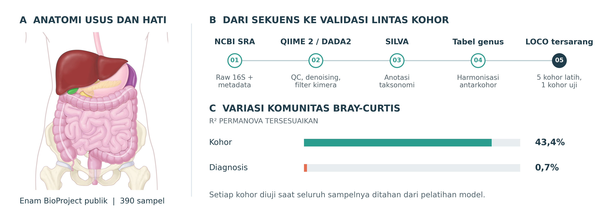

# Analisis Mikrobioma Usus Lintas Kohor untuk MASLD

Repositori ini memuat kode dan hasil eksperimen untuk menguji hubungan mikrobioma usus dengan penyakit hati steatotik terkait disfungsi metabolik (MASLD). Fokusnya adalah konsistensi sinyal taksonomi dan kemampuan model pembelajaran mesin untuk bekerja pada kohor yang tidak digunakan saat pelatihan. Naskah penelitian dan tabel kelimpahan masukan tidak dipublikasikan di sini.



*Ikhtisar analisis enam kohor saat ini. Ilustrasi anatomi panel A berasal dari [NIDDK, National Institutes of Health](https://www.niddk.nih.gov/news/media-library/23135) dan dipotong untuk tata letak. Versi [PDF dengan teks dan diagram vektor](assets/ikhtisar_studi.pdf) serta rincian atribusi tersedia di [daftar aset](assets/README.md).*

## Cakupan dan status

Data saat ini berasal dari enam BioProject publik NCBI Sequence Read Archive (SRA): PRJNA1089365, PRJNA1152299, PRJNA1370285, PRJNA720274, PRJNA851946, dan PRJNA962007. Analisis mencakup 390 sampel dari Thailand, Tiongkok, dan Spanyol: 299 kasus dan 91 kontrol. Setelah harmonisasi, terdapat 820 fitur taksonomi.

**Kohor Indonesia masih dalam proses pengumpulan dan belum termasuk dalam data, angka, atau gambar pada repositori ini.** Persiapan integrasinya dicatat dalam [checklist kohor Indonesia](docs/indonesia_cohort_integration.md). Penambahan kohor tersebut akan memerlukan pemeriksaan data dan perhitungan ulang seluruh hasil yang bergantung pada komposisi kohor.

## Asal data dan alur analisis

Pembacaan mentah 16S rRNA beserta metadata diperoleh dari NCBI SRA. Data diproses menggunakan QIIME 2 dan DADA2 untuk kendali mutu, denoising, dan penyaringan kimera. Anotasi taksonomi menggunakan SILVA; fitur kemudian diagregasi pada tingkat genus. Tabel kelimpahan yang dihasilkan diharmonisasi antarkohor sebelum analisis statistik dan pembelajaran mesin.

Kode dalam `src/run_analysis.py` dimulai dari tabel kelimpahan hasil pemrosesan tersebut. Kode ini mencakup ordinasi Bray-Curtis, PERMANOVA tersesuaikan kohor, meta-analisis takson dengan efek acak, serta evaluasi SVM, random forest, MLP, dan CNN 1D menggunakan validasi *nested leave-one-cohort-out* (LOCO). Penyaringan fitur, transformasi, pemilihan model, dan penentuan ambang dilakukan tanpa akses ke kohor uji luar.

Dokumentasi lengkap perintah, artefak, versi, dan parameter pipeline QIIME 2/DADA2/SILVA belum disertakan. Karena itu, tahap bioinformatika hulu belum dapat direproduksi sepenuhnya dari repositori ini. Tidak ada nilai parameter hulu yang diasumsikan untuk mengisi kekosongan tersebut.

## Struktur repositori

| Lokasi | Isi |
| --- | --- |
| `src/` | Implementasi dan petunjuk analisis hilir |
| `results/` | Audit data, prediksi tingkat sampel, metrik, statistik, dan gambar analitik |
| `assets/` | Aset visual terpilih dari naskah, beserta atribusinya |
| `docs/` | Checklist integrasi kohor Indonesia |
| `requirements.txt` | Dependensi Python yang digunakan |

Folder lokal `OTU-table/` berisi tabel kelimpahan dan metadata masukan. Folder tersebut, bersama `paper/`, diabaikan oleh Git. Hasil yang sudah dihitung tersedia untuk ditelaah, tetapi menjalankan ulang pipeline memerlukan berkas masukan lokal.

## Menjalankan analisis

Siapkan Python 3.12 dan `uv`, kemudian tempatkan tabel serta metadata pada `OTU-table/` sesuai nama berkas yang ditentukan dalam daftar `COHORTS` di `src/run_analysis.py`. Dari akar proyek, jalankan:

```bash
uv venv .venv --python 3.12
uv pip install --python .venv/bin/python -r requirements.txt --extra-index-url https://download.pytorch.org/whl/cpu
.venv/bin/python src/run_analysis.py
```

Untuk membuat ulang gambar dari hasil numerik yang sudah ada tanpa melatih ulang model:

```bash
.venv/bin/python src/run_analysis.py --figures-only
```

Mode gambar tetap membutuhkan masukan lokal `OTU-table/` untuk ordinasi dan pemeriksaan keselarasan sampel. Gambar analitik disimpan di `results/figures/`. Aset ikhtisar khusus naskah hanya diperbarui bila ilustrasi lokal tersedia di `paper/visualization/`.

## Interpretasi hasil

Pada enam kohor saat ini, efek kohor menjelaskan 43,4% variasi komunitas Bray-Curtis setelah penyesuaian diagnosis, sedangkan diagnosis menjelaskan 0,7% setelah penyesuaian kohor. AUROC gabungan luar kohor terbaik adalah 0,684 untuk SVM. Temuan ini menunjukkan adanya sinyal mikrobioma, sekaligus keterbatasan generalisasi lintas studi. Model yang tersedia **belum tervalidasi sebagai alat skrining klinis**.
